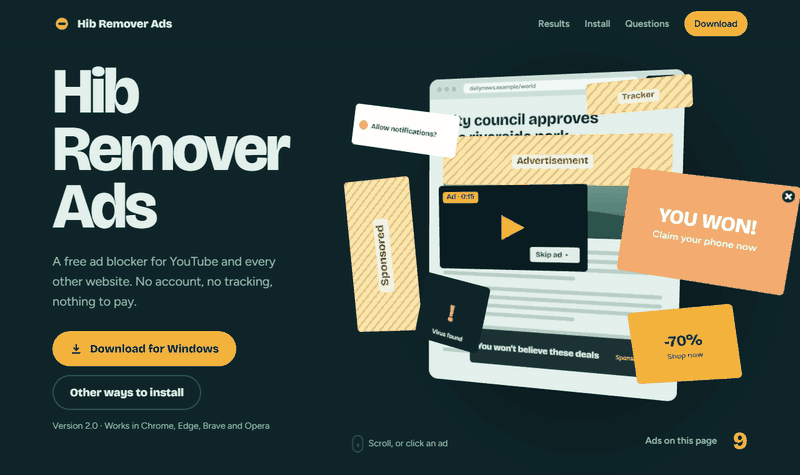
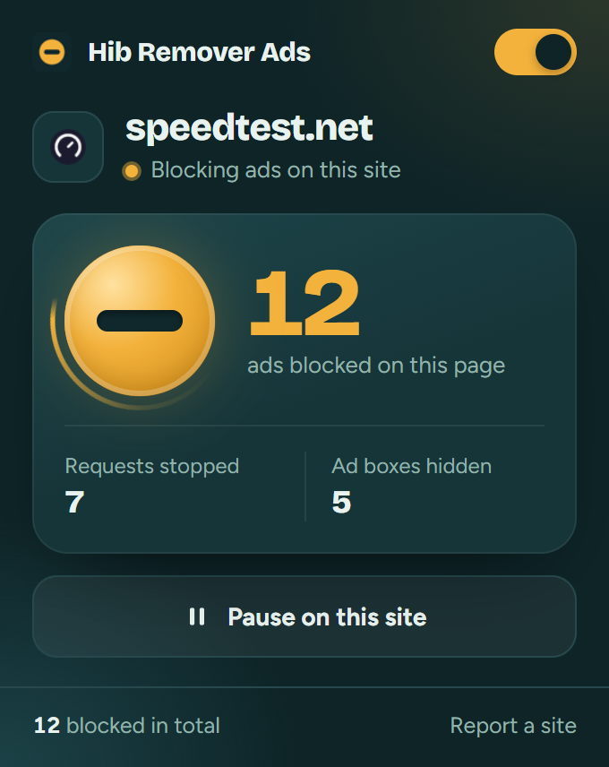

<div align="center">


# Hib Remover Ads

**A free, open-source ad blocker for Chrome, Edge, Brave and Opera.**<br>
Removes YouTube video ads, banners, popups, trackers and "turn off your ad blocker" walls, and makes pages load faster.

[](https://github.com/ZakariaHibaoui2/hib-remover-ads/releases/latest/download/HibRemoverAds-Setup.exe)
[-183a3f?style=for-the-badge&logo=googlechrome&logoColor=e4f0ec)](https://github.com/ZakariaHibaoui2/hib-remover-ads/releases/latest/download/hib-remover-ads.zip)

[](https://github.com/ZakariaHibaoui2/hib-remover-ads/releases/latest)
[](https://github.com/ZakariaHibaoui2/hib-remover-ads/releases)
[](https://github.com/ZakariaHibaoui2/hib-remover-ads/actions/workflows/ci.yml)
[](LICENSE)
[](https://github.com/ZakariaHibaoui2/hib-remover-ads/stargazers)

[Website](https://zakariahibaoui2.github.io/hib-remover-ads/) · [Install](#install-in-one-minute) · [Results](#tested-on-real-websites) · [Privacy](PRIVACY.md) · [Report an ad that got through](https://github.com/ZakariaHibaoui2/hib-remover-ads/issues/new?template=ad-got-through.yml)

<br>



</div>

<br>

## Why Hib Remover Ads

<table>
<tr>
<td width="56%" valign="top">

- **Blocks what the big blockers block.** It compiles EasyList, EasyPrivacy, uBlock Origin's lists, Liste FR and Liste AR into about 17,000 blocking rules and 15,700 hiding rules.
- **YouTube without ads.** It removes the ad instructions from YouTube's player data, so most video ads never start. If one slips through, it gets muted and skipped.
- **Gets past anti-adblock walls.** About 4,600 site-specific fixes switch off "please disable your ad blocker" checks and popunders.
- **Makes pages faster.** Ads never download, so CNN loaded in 4.3 s instead of 35.9 s in our test.
- **Private by design.** No account, no analytics, no servers. Nothing leaves your browser. See [PRIVACY.md](PRIVACY.md).
- **One click per site.** Pause it on any site from the toolbar, or turn it off everywhere.

</td>
<td width="44%" valign="top" align="center">



</td>
</tr>
</table>

## Install in one minute

Hib Remover Ads isn't on the Chrome Web Store yet, so you load it yourself. You only do this once.

### Windows (recommended)

1. Download **[HibRemoverAds-Setup.exe](https://github.com/ZakariaHibaoui2/hib-remover-ads/releases/latest/download/HibRemoverAds-Setup.exe)** and run it. If Windows says *"Windows protected your PC"*, click **More info**, then **Run anyway**. The installer isn't signed with a paid certificate; its full source is in [`installer/Setup.cs`](installer/Setup.cs).
2. Pick your browser and click **Install**. The extension is unpacked to `%LOCALAPPDATA%\Hib Remover Ads\extension`, the folder path is copied, and your browser opens its extensions page.
3. Turn on **Developer mode** (top right), click **Load unpacked**, press **Ctrl+V** in the folder box and click **Select Folder**.

### Mac, Linux or by hand

1. Download **[hib-remover-ads.zip](https://github.com/ZakariaHibaoui2/hib-remover-ads/releases/latest/download/hib-remover-ads.zip)** and extract it to a folder you'll keep.
2. Open `chrome://extensions` (or `edge://extensions`, `brave://extensions`), turn on **Developer mode**.
3. Click **Load unpacked** and choose the folder.

Then pin it from the puzzle-piece menu to see its counter. To update, run the newest installer (or replace the folder) and click the reload arrow on the extension's card.

> [!TIP]
> Keep Developer mode switched on. Chrome disables unpacked extensions when it's off. If Chrome shows a "Disable developer mode extensions" bubble, close it with the X.

## Tested on real websites

Each site was loaded twice in a fresh Chromium profile, without and with Hib Remover Ads.

**Speed** (median of 2 runs, from [`tests/test_performance.py`](tests/test_performance.py)):

| Site | Load time | Main-thread CPU | JS memory | Network requests |
|---|---|---|---|---|
| cnn.com | 35.9 s → **4.3 s** | −81% | −43% | 641 → 138 |
| weather.com | 5.2 s → **1.0 s** | −76% | −86% | 936 → 124 |
| hespress.com | 1.9 s → **0.5 s** | −68% | −87% | 135 → 42 |
| speedtest.net | 1.3 s → 1.2 s | −70% | −52% | 2,468 → 36 |
| forbes.com | 3.3 s → **1.9 s** | −32% | −52% | 457 → 184 |
| Ad-free test page | 14 ms → 36 ms | +20 ms | +0.3 MB | same |

The last row is the extension's own cost on a page with nothing to block: about 20 ms, well under what anyone can notice.

**Blocking** across ad-heavy sites, from [`tests/test_real_sites.py`](tests/test_real_sites.py): ad requests that loaded dropped from hundreds per page to 0–2, visible ad slots went to 0, and page text stayed the same. The full table is on the [website](https://zakariahibaoui2.github.io/hib-remover-ads/#proof). On [adblock-tester.com](https://adblock-tester.com/) it scores **100/100**.

Results vary by country and over time; these were measured from Morocco in October 2026.

## How it works

| Layer | What it does | Where |
|---|---|---|
| Network blocking | Chrome's built-in declarativeNetRequest engine blocks ad and tracker requests before they download. No request ever passes through extension code. | [`src/rules/`](src/rules) |
| Element hiding | A stylesheet hides leftover ad boxes on every site; per-site rules are injected for the site you're on. | [`src/content/generic.css`](src/content/generic.css), [`src/rules/cosmetic.json`](src/rules/cosmetic.json) |
| Scriptlets | Small per-site patches, ported from uBlock Origin, that defuse anti-adblock checks, popunders and ad timers. Only injected on the ~3,100 sites that need one. | [`src/scriptlets/`](src/scriptlets) |
| YouTube | Strips ad placements from player data before the player reads it; a fallback mutes and skips any ad that still plays. | [`src/content/yt-main.js`](src/content/yt-main.js), [`src/content/youtube.js`](src/content/youtube.js) |
| Popup | Per-page and all-time counts, pause per site, global switch. | [`src/popup/`](src/popup) |

Permissions and why each is needed are listed in [PRIVACY.md](PRIVACY.md#permissions).

## Build from source

```sh
python tools/filterlists.py --fetch   # download the filter lists and compile them (needs Python + Playwright)
node tools/build.mjs                  # compile the curated list in tools/filters.mjs
python installer/build.py             # store/hib-remover-ads.zip and store/HibRemoverAds-Setup.exe (Windows)
```

Tests:

```sh
python -m playwright install chromium
python tests/test_extension.py     # 20 end-to-end checks: blocking, hiding, popup, pause, YouTube
python tests/test_real_sites.py    # ad-heavy sites with and without the extension
python tests/test_performance.py   # load time, CPU and memory with and without the extension
```

A [weekly workflow](.github/workflows/update-filters.yml) refreshes the filter lists and opens a pull request when they change.

## Limits

- Chrome caps extensions at 30,000 enabled rules, so the lists are compiled to fit that budget.
- Regex network rules and procedural cosmetic filters can't be expressed in Chrome's rule format and are skipped, so a few site-specific ads that uBlock Origin catches may get through. [Report them](https://github.com/ZakariaHibaoui2/hib-remover-ads/issues/new?template=ad-got-through.yml).
- YouTube changes its ad delivery often. If ads come back, update to the latest release.

## Contributing

Bug reports, missed ads and pull requests are welcome. See [CONTRIBUTING.md](CONTRIBUTING.md). Security issues: see [SECURITY.md](SECURITY.md).

If Hib Remover Ads saves you time, **[give it a star](https://github.com/ZakariaHibaoui2/hib-remover-ads/stargazers)**. It helps other people find it.

## Credits and license

Made by [Zakaria Hibaoui](https://github.com/ZakariaHibaoui2). Licensed under [GPL-3.0](LICENSE).

Filter lists by the [EasyList](https://easylist.to/) authors, [uBlock Origin](https://github.com/uBlockOrigin/uAssets) contributors, Liste FR and Liste AR maintainers, used under GPL-3.0. Scriptlet behaviour follows uBlock Origin's. Fonts: [Bricolage Grotesque](https://github.com/ateliertriay/bricolage) and [Figtree](https://github.com/erikdkennedy/figtree), SIL Open Font License.

Hib Remover Ads is an independent project and isn't affiliated with Google, YouTube, uBlock Origin or EasyList.
